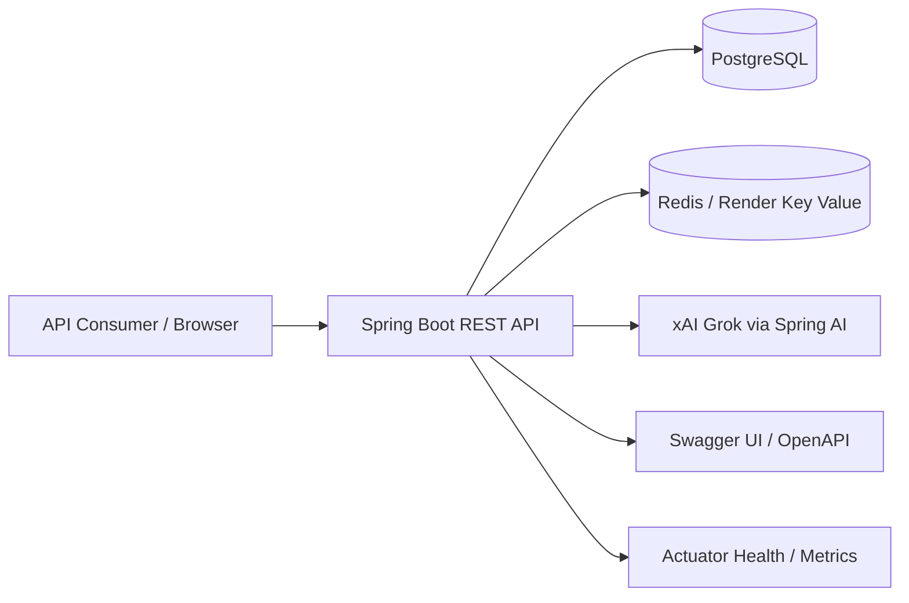

# URL Shortener API

Production-ready Spring Boot backend for creating short links, tracking engagement, and generating Grok-powered growth insights.

## Overview

This repository contains a backend-only URL shortener platform built for teams that need more than basic link redirection. It solves the common problem of managing short links while also capturing click analytics, enforcing authentication, rate limiting traffic, and surfacing AI-generated insights from real usage data.

It is designed for product teams, marketers, and engineering teams that want a secure URL shortener service with operational visibility. There is no frontend, blockchain layer, or smart contract system in this repository.

## Key Features

- JWT-based authentication with register, login, and refresh-token flows
- Secure short-link creation, listing, updating, disabling, deleting, and redirect handling
- Click analytics for daily, weekly, monthly, and top-dimension reporting
- Redis-backed caching and request rate limiting
- Operations reporting for service-level visibility
- AI-powered alias suggestions, traffic summaries, anomaly explanations, and marketing insights
- Swagger/OpenAPI documentation via Springdoc
- Dockerized deployment with a Render blueprint

## System Architecture



The backend is organized as a stateless REST service:

- Controllers expose the public API
- Services implement business logic and analytics aggregation
- Repositories persist entities in PostgreSQL through Spring Data JPA
- Redis handles caching and rate limiting
- Spring AI calls xAI's OpenAI-compatible API when AI features are enabled

## Technology Stack

- Java 17
- Spring Boot 3.3
- Spring Web
- Spring Security
- Spring Data JPA
- Spring Data Redis
- Spring AI
- Flyway
- PostgreSQL
- Redis
- Docker
- Render

## Engineering Decisions

- Stateless security: JWT access tokens plus hashed refresh tokens stored in the database
- Cache-first performance: Redis is used for short-link caching and API rate limiting
- Schema versioning: Flyway migrations keep database changes reproducible
- Production observability: Actuator health and info endpoints support deployment checks
- AI with business context: Grok is used only for value-added tasks such as alias generation and analytics interpretation
- No fake AI endpoint: AI calls go through xAI's OpenAI-compatible API only when enabled

## Data Model

The application persists four core entities:

- `users`
  - user identity, password hash, role, enabled flag, timestamps
- `refresh_tokens`
  - hashed refresh token, linked user, expiry, revoked flag, timestamps
- `short_urls`
  - original URL, short code, optional custom alias, click count, enabled flag, expiry, owner, timestamps
- `click_events`
  - click metadata such as IP, country, city, browser, OS, device, referral, timestamp, plus links to the short URL and owner

Useful indexes are created for:

- `short_code`
- `created_by_id`
- `expires_at`
- `clicked_at`
- `country`
- `browser`
- `device`
- `custom_alias`
- `created_at`

## API Surface

Base path: `/api/v1`

### Auth

- `POST /auth/register`
- `POST /auth/login`
- `POST /auth/refresh`

### URLs

- `POST /urls`
- `GET /urls`
- `PATCH /urls/{shortUrlId}`
- `PATCH /urls/{shortUrlId}/status`
- `DELETE /urls/{shortUrlId}`
- `GET /r/{shortCode}`

### Analytics

- `GET /analytics/dashboard`
- `GET /analytics/daily`
- `GET /analytics/weekly`
- `GET /analytics/monthly`
- `GET /analytics/top-countries`
- `GET /analytics/top-browsers`
- `GET /analytics/top-devices`
- `GET /analytics/top-urls`
- `GET /analytics/top-users`

### Reports

- `GET /reports/operations`

### AI

- `POST /ai/aliases/suggestions`
- `GET /ai/traffic/summary`
- `GET /ai/analytics/explain`
- `GET /ai/analytics/recommendations`
- `POST /ai/analytics/questions`
- `GET /ai/traffic/unusual`
- `GET /ai/marketing/insights`

### Health and Docs

- `GET /api/v1/health`
- `GET /actuator/health`
- `GET /swagger-ui/index.html`
- `GET /v3/api-docs`

## Project Structure

```text
src/main/java/com/project/urlshortener
  ai/           Grok integration and traffic anomaly logic
  cache/        Redis cache and rate limiting
  config/       Application, security, JWT, Redis, and AI configuration
  controller/   REST controllers
  dto/          Request and response models
  entity/       JPA entities
  exception/    Domain exceptions and global exception handling
  filter/       Security and rate-limit filters
  repository/   Spring Data repositories
  security/     JWT authentication support
  service/      Service interfaces
  service/impl/ Service implementations
  util/         Shared utilities
src/main/resources/db/migration
  V1__create_auth_tables.sql
  V2__create_short_urls_table.sql
  V3__create_click_events_table.sql
  V4__add_short_url_management_indexes.sql
```

## Local Setup

### Prerequisites

- Java 17
- Maven 3.9+
- PostgreSQL
- Redis

### Environment Variables

Minimum local configuration:

- `DB_URL`
- `DB_USERNAME`
- `DB_PASSWORD`
- `REDIS_URL`
- `JWT_SECRET`
- `APP_BASE_URL`

Optional configuration:

- `APP_AI_ENABLED`
- `XAI_API_KEY`
- `XAI_BASE_URL`
- `XAI_MODEL`
- `XAI_TEMPERATURE`
- `XAI_MAX_TOKENS`
- `SHORT_URL_CODE_LENGTH`
- `SHORT_URL_GENERATION_ATTEMPTS`
- `JWT_ACCESS_TOKEN_SECONDS`
- `JWT_REFRESH_TOKEN_SECONDS`

### Run Locally

```bash
mvn spring-boot:run
```

### Run Tests

```bash
mvn test
```

## Database and Persistence

The project uses PostgreSQL with Flyway migrations and Spring Data JPA.

Highlights:

- IDs are generated with identity columns
- Refresh tokens are stored as hashes, not raw tokens
- Short URLs track ownership, click counts, expiry, and custom aliases
- Click events store analytics metadata for reporting and anomaly detection

## AI Design

AI is intentionally narrow and business-focused.

When `APP_AI_ENABLED=true` and `XAI_API_KEY` is present, the app uses Spring AI with xAI's OpenAI-compatible API to:

- generate better aliases
- generate SEO-friendly aliases
- suggest custom aliases
- explain analytics trends
- summarize traffic
- detect unusual traffic
- generate marketing insights
- answer questions about analytics

The AI layer does not use a vector database, RAG pipeline, or fake local stub. It builds prompts from the app's own analytics and reporting data.

## Testing

The repository includes tests for:

- controllers
- service implementations
- cache and rate-limiting behavior
- anomaly detection
- exception handling

The build also includes H2 for test execution and Testcontainers support for container-backed tests.

## Deployment

The repository includes a Dockerfile and a Render blueprint.

### Render

Render provisions:

- the web service
- PostgreSQL
- Redis-compatible Key Value storage

Deploy steps:

1. Push the repository to GitHub.
2. In Render, create a new Blueprint and connect the repo.
3. Render reads `render.yaml` and creates the infrastructure.
4. Add `XAI_API_KEY` if you want the AI endpoints enabled.
5. Deploy and wait for `/actuator/health` to become healthy.
6. Keep `APP_AI_ENABLED=false` until your xAI key is ready, then set it to `true`.

### Docker

The container image builds the application in a multi-stage Dockerfile and exposes port `10000`.

## Implementation Notes

- The application is backend-only; there is no frontend in this repository
- No blockchain or smart-contract layer is included
- The codebase currently focuses on URL management, analytics, security, caching, and Grok-powered insights
- No GitHub Actions or other CI workflow files are committed in the repository

## Future Improvements

- Add a frontend client for managing links and viewing analytics
- Expand role-based access control and admin tooling
- Add exportable reports and scheduled email summaries
- Introduce more advanced campaign attribution
- Add more integration tests for persistence and deployment flows

## License

No license has been specified yet.
